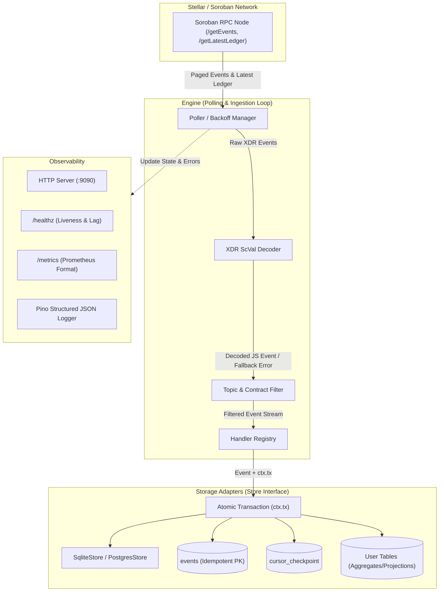

# Architecture & Design Specifications

`soroban-event-indexer` is engineered as a deterministic, resilient event ingestion toolkit for the Soroban smart contract platform on Stellar. This document details its subsystem boundaries, delivery guarantees, transactional model, and failure recovery.

## 1. Guarantees & Transactional Lifecycle

### At-Least-Once RPC Fetch + Idempotent Storage = Effectively-Once Processing
Soroban RPC pagination cursors guarantee that queries fetching from a cursor retrieve all ledgers matching the filter without loss. However, network retries or process restarts may re-fetch already observed events.

To guarantee that derived application state is never corrupted or duplicated:
1. **Unique Primary Key on Event ID**: The `events` table defines `id TEXT PRIMARY KEY`. Re-inserting an existing event uses `INSERT OR IGNORE` (SQLite) or `ON CONFLICT (id) DO NOTHING` (Postgres).
2. **Atomic Batch Commit**: Handlers process a batch of events within a database transaction (`ctx.tx`). The insertion of the event records, the invocation of user handlers writing to derived tables, and the update of the cursor checkpoint occur **within the same physical transaction**.
3. **Crash Invariance**: If the process crashes or an uncaught exception occurs at any point before commit, the database rolls back the entire batch: no events are recorded, derived rows are discarded, and the cursor remains at the previous valid checkpoint. Upon restart, the engine safely resumes from the saved cursor.

## 2. Ledger Finality vs Reorgs
Stellar uses the Stellar Consensus Protocol (SCP), which features deterministic, fast finality (typically 3 to 5 seconds per ledger closed) with no probabilistic reorganizations.
- **Assumption**: Unlike Proof-of-Work chains, ledger forks or orphan blocks do not occur in normal Soroban operation.
- **RPC Retention Window**: Soroban RPC nodes retain a bounded ledger window (typically a few thousand to tens of thousands of ledgers). If the indexer's cursor lags behind the RPC node's oldest retained ledger, the engine immediately terminates with an actionable error directing the operator to perform backfill or use an archive provider, rather than silently dropping historical ledgers.

## 3. Subsystem Breakdown

### `src/decode`
- Converts raw Soroban XDR `ScVal` structures into native JavaScript values:
  - `i128`, `u128`, `i64`, `u64`, `i256`, `u256` $\rightarrow$ native `bigint`.
  - Symbols, strings, and account/contract addresses $\rightarrow$ strings.
  - Booleans, bytes (hex/Buffer), and vectors/maps $\rightarrow$ arrays and objects.
- **Decode Fault Tolerance**: If an unexpected ScVal format is encountered, the event is marked with `decodeError: true` and the error reason, while preserving the raw base64 XDR. The ingestion engine never crashes due to schema shifts.

### `src/engine`
- Manages the polling loop, ledger cursor, page boundaries, and backoff timing.
- Handles RPC transient errors (503s, 429s, network drops) using exponential backoff with jitter.
- Supports graceful shutdown via `SIGINT`/`SIGTERM` by completing in-flight transactions before exiting.

### `src/storage`
- Defines the `Store` interface abstracting transaction boundaries, cursor management, and event persistence.
- Provides two native implementations:
  - `SqliteStore`: Single-file embedded storage with WAL mode enabled.
  - `PostgresStore`: Connection pool (`pg.Pool`) with transactional client leases.

### `src/handlers`
- A typed event dispatcher (`indexer.on(pattern, handler)`).
- Wildcard matching on topic patterns (e.g. `["VeryPrince", "*"]` or `["*", "OrgFunded"]`).
- If any handler throws, the transaction is rolled back, exponential backoff is triggered, and after max retries the engine exits with a documented non-zero exit code.
